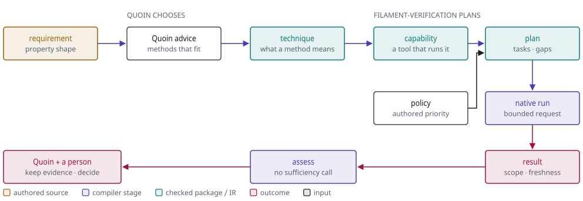
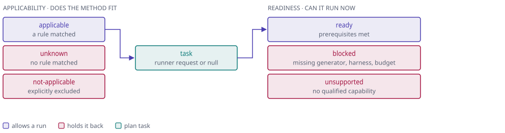

# filament-verification

[](https://discord.gg/k8DVhuYBR2)
[](https://github.com/agent-ix/filament-spec-language)

filament-verification is a Rust crate that turns a requirement into an explicit
verification plan: which techniques apply, which tool capability could run each
one, and what is still missing.

It defines portable, versioned contracts for tool qualification, blocked tasks
and stale results, and plans against them. Quoin supplies the verification
methods that fit a requirement and keeps the evidence, and a person decides
whether the evidence is enough. Native producers run the ready tasks and return
results for the crate to assess.

<picture>
  <source media="(prefers-color-scheme: dark)" srcset="docs/images/hero-dark.svg">
  
</picture>

## Getting started

Add the crate as a Git dependency (Rust 1.98.1 or newer):

```toml
[dependencies]
filament-verification = { git = "https://github.com/agent-ix/filament-verification" }
```

Or build from a clone:

```sh
git clone https://github.com/agent-ix/filament-verification
cd filament-verification
cargo build --locked
```

## The five contracts

All five are defined in [`contracts/e02-draft-2.schema.json`](contracts/e02-draft-2.schema.json)
and validated through the public `filament-verification-contracts` crate.

| Contract | What it says |
|---|---|
| `TechniqueDefinition` | What a verification method means and where it may apply. Keeps Quoin's method id byte for byte. |
| `ToolCapability` | Binds one technique to a native producer and adapter, with input kinds, prerequisites, resource limits, qualification state and claim limits. |
| `SelectionPolicy` | Explainable rules with source provenance and an authored priority (`required`, `recommended`, `optional`). An expired policy adds a freshness prerequisite. |
| `VerificationPlan` | An inventory of properties, then tasks. Each task has one of five input shapes: `state`, `relational`, `trace`, `fault` or `manual`. |
| `TechniqueResult` | One run's outcome with execution status, logical outcome, activation, assumptions, observation adequacy, exact scope and provenance kept as separate fields. |

## How a plan is built

Applicability and readiness are separate answers, so a method that fits but
cannot run yet stays visible in the plan.

<picture>
  <source media="(prefers-color-scheme: dark)" srcset="docs/images/task-states-dark.svg">
  
</picture>

- Quoin's `inconclusive` advice becomes `unknown`.
- Missing generators, harnesses, tools, permissions, observations or reviewer
  assignments are listed as prerequisites to satisfy.
- Fault tasks stay blocked without an explicit non-production authorization
  and an injection binding.
- A native runner request is closed and finite: the selected capability,
  adapter, permissions, input and one budget. Manual work never receives
  invocation permission.

Evidence assessment then compares each result with the plan: exact
plan/task/run/producer/adapter binding, scope, freshness, and every
simultaneous finding. Ambiguous duplicate results are reported.

## Usage

The library entry points take and return JSON values. Each plan request carries
shared references; the caller validates them and passes the validated set
along:

```rust
use filament_verification::catalog::adapt_quoin_catalog;
use filament_verification::evidence::assess_evidence;
use filament_verification::planner::build_verification_plan;

// Quoin's catalog export -> the crate's technique definitions
let techniques = adapt_quoin_catalog(&catalog_export)?;
// plan request + validated shared references -> VerificationPlan
let plan = build_verification_plan(&request, &references)?;
// evidence packet + validated shared references -> assessment
let assessment = assess_evidence(&packet, &references)?;
```

[`fixtures/portfolio.json`](fixtures/portfolio.json) holds a complete plan
request in its `planRequest` member.

The command-line tools run the checked-in fixtures:

```sh
cargo run --locked --bin validate-fixtures      # every fixture against the schema
cargo run --locked --bin render-fixtures        # the retained evidence packet
cargo run --locked --bin run-bounded-portfolio -- "$(git rev-parse HEAD)" 2026-09-08T02:00:00Z
```

`run-bounded-portfolio` checks catalog field parity keyed by `techniqueId` and
permutation invariance. A violated check or a failed execution is kept as its
own `TechniqueResult`, and an `inspection` result stays `not-run` until a
person records the disposition.

## Values

| Dimension | Values |
|---|---|
| Input shape | `state`, `relational`, `trace`, `fault`, `manual` |
| Applicability | `applicable`, `not-applicable`, `unknown` |
| Readiness | `ready`, `blocked`, `unsupported` |
| Execution status | `not-run`, `running`, `completed`, `failed`, `cancelled`, `exhausted`, `invalid-input`, `unsupported` |
| Logical outcome | `satisfied`, `violated`, `unknown`, `not-evaluated`, `inconclusive` |

Oracle contributions record whether a result's oracle and observation are
independent, shared, derived or unknown. Further reading:
[interface decision](docs/interface-decision.md),
[Quoin compatibility map](docs/quoin-compatibility.md),
[contract packet](contracts/README.md) and the
[historical evaluation report](docs/evaluation-report.md).

## Filament ecosystem

<picture>
  <source media="(prefers-color-scheme: dark)" srcset="docs/images/ecosystem-dark.svg">
  
</picture>

filament-verification sits above the main chain. It depends on
`filament-verification-contracts` (the schema and canonicalization boundary),
`filament-analyze` (method contract) and `engineering-assurance` (native
execution and evidence), all from `Cargo.toml`. Quoin supplies the catalog and
advice across a versioned JSON boundary and keeps its own orchestration.

## Building and testing

```sh
cargo fmt --all -- --check
cargo clippy --workspace --all-targets --all-features --locked -- -D warnings
cargo test --workspace --all-features --locked
cargo fuzz build -D --sanitizer none
cargo deny check
```

## Contributing and license

Every contribution needs a signed CLA; see [CONTRIBUTING.md](CONTRIBUTING.md)
and [CLA.md](CLA.md). The code is AGPL-3.0-or-later ([LICENSE](LICENSE)).
